# HealthTwin AI — Intelligent Emergency Response System

> **Simulated prototype for a college project.** No real hospital, ambulance, SMS or emergency number is ever contacted. Nothing here is a medical device or medical advice, and the app never diagnoses. Medical wording, symptom rules and the Hindi/Gujarati text are drafts that a doctor and a native speaker have **not** reviewed yet.

A patient app watches (simulated) wearable data, and when the patient sends an SOS the nearest hospital gets an alert with only the information the patient agreed to share. The hospital acknowledges, dispatches a (simulated) ambulance, and the patient, their family and volunteers see every step live.

<p align="center">
  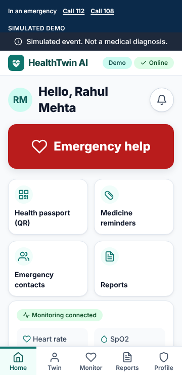
  
  
</p>
<p align="center"><em>Patient app: home and digital twin · live emergency timeline · “Who saw my data”</em></p>


<p align="center"><em>Hospital portal: alert queue, bed and ICU availability, acknowledge and dispatch</em></p>

## What it does

| Area | What you get |
|---|---|
| **Patient app** | Login, profile, simulated wearable vitals, “digital twin” compared with the patient’s usual range, one-tap emergency with a 10-second cancel countdown, live status timeline |
| **Privacy by design** | Four consent switches. A field reaches a relative or volunteer only if the patient allowed it when sending the SOS **and** still allows it now. Every release is logged by field name (never values) |
| **Who saw my data** | A live list of everyone other than the patient who looked at their information, what they saw, and whether they were blocked |
| **Health passport** | A QR link with an expiry time that a paramedic can open without an account; read-only, revocable, logged |
| **Hospital portal** | Alert queue, map, ambulance fleet, acknowledge / dispatch / hand-over, bed and ICU updates, history, activity log, analytics, English / Hindi / Gujarati |
| **Family, volunteer, admin** | Invite-code family link with check-ins, verified volunteer responders, admin user and content management |
| **Escalation** | If a hospital does not acknowledge in time, the alert escalates to the next hospital |
| **Backend** | FastAPI + SQLite, encrypted personal data, append-only audit log, role-based access, 76 contract endpoints, WebSocket live events |

## Screens

| Patient consent | Health passport | Volunteer view |
|---|---|---|
|  | 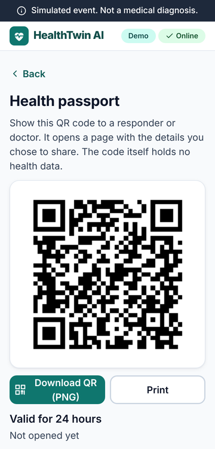 |  |

| Alert detail | Dispatch confirm | Hindi interface |
|---|---|---|
| 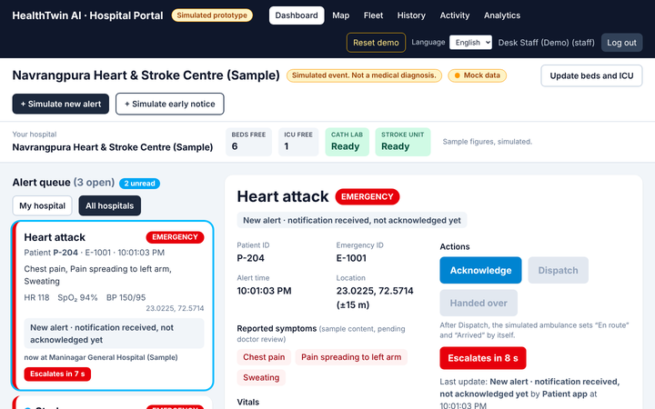 | 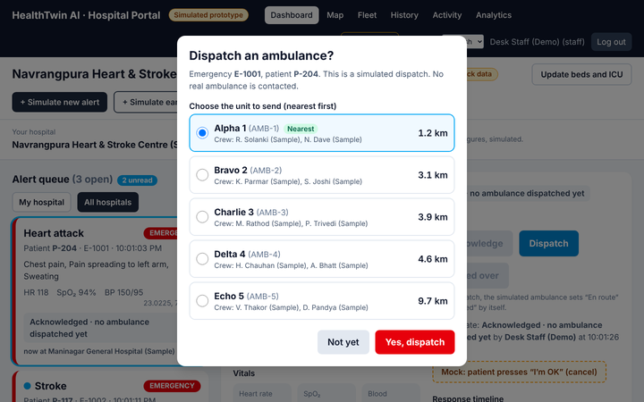 |  |

## Digital-twin dashboard (patient app)

A dark, clinical-looking dashboard sits on top of the same data and hooks as the older screens. Everything on it is **simulated**: it never diagnoses, and each number is labelled as live-simulated, entered by you, or an assumption.

| Overview | 3D twin | Disease intelligence |
|---|---|---|
| 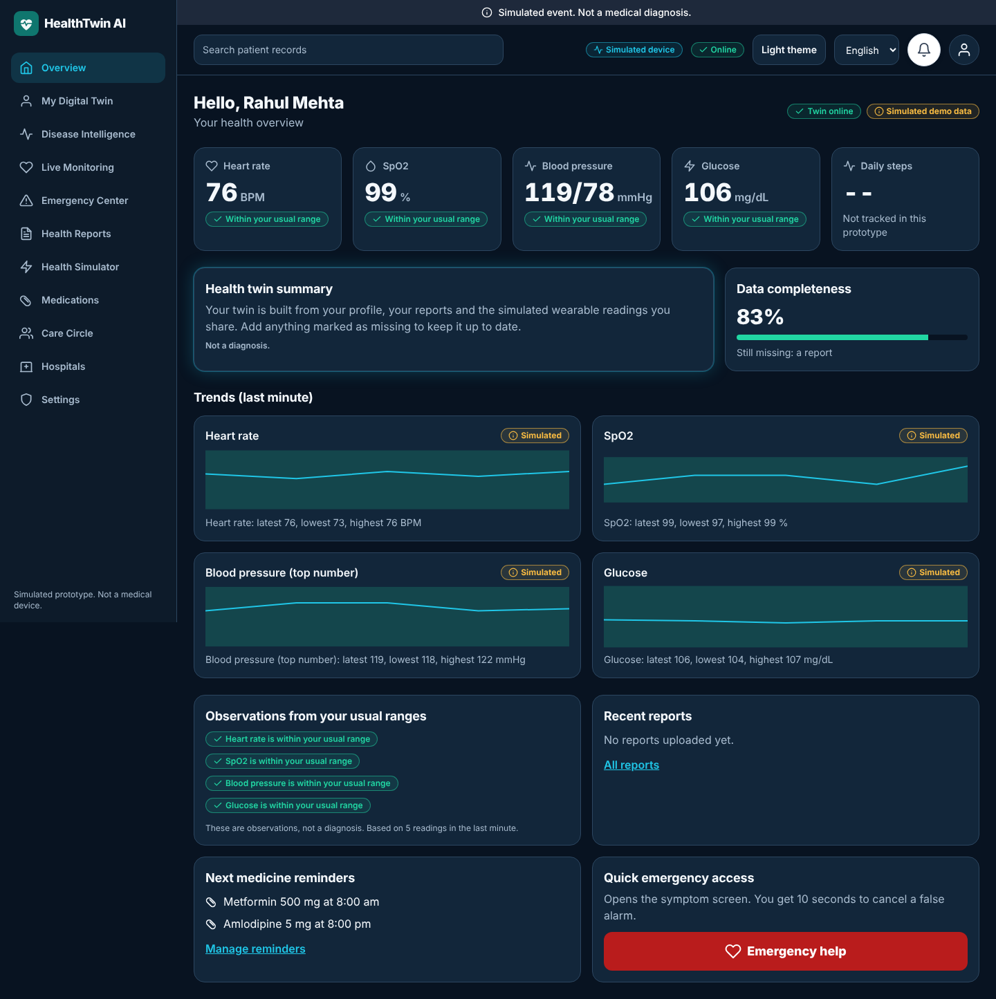 | 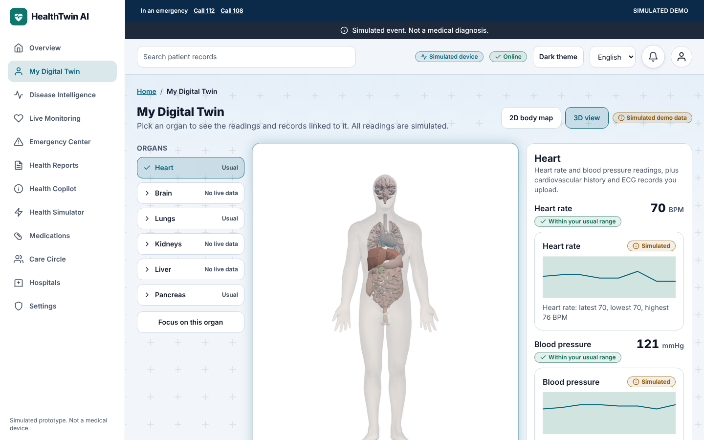 | 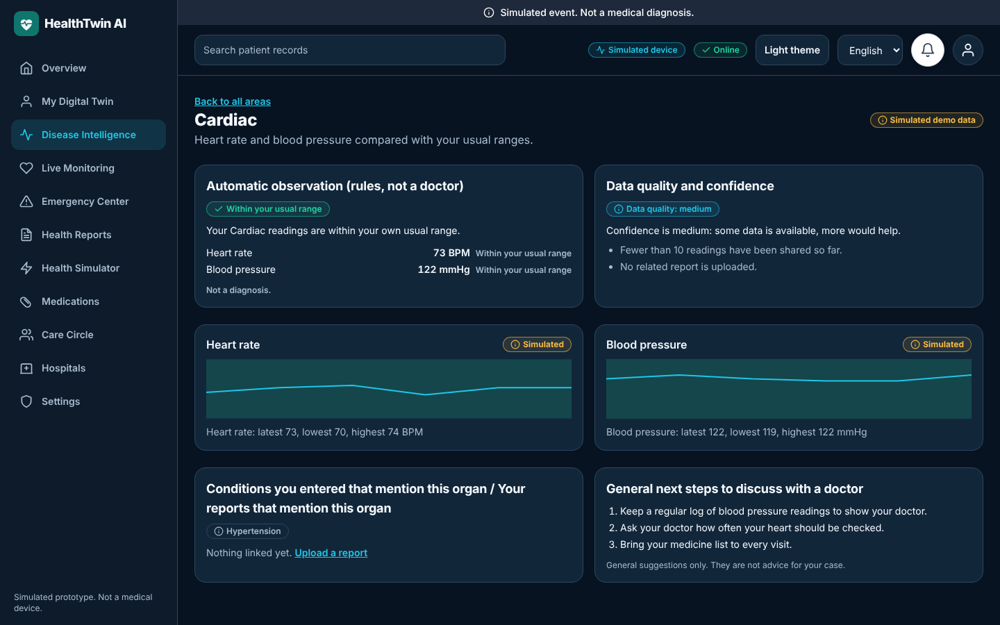 |

| Emergency Center | Simulator | Care Circle |
|---|---|---|
| 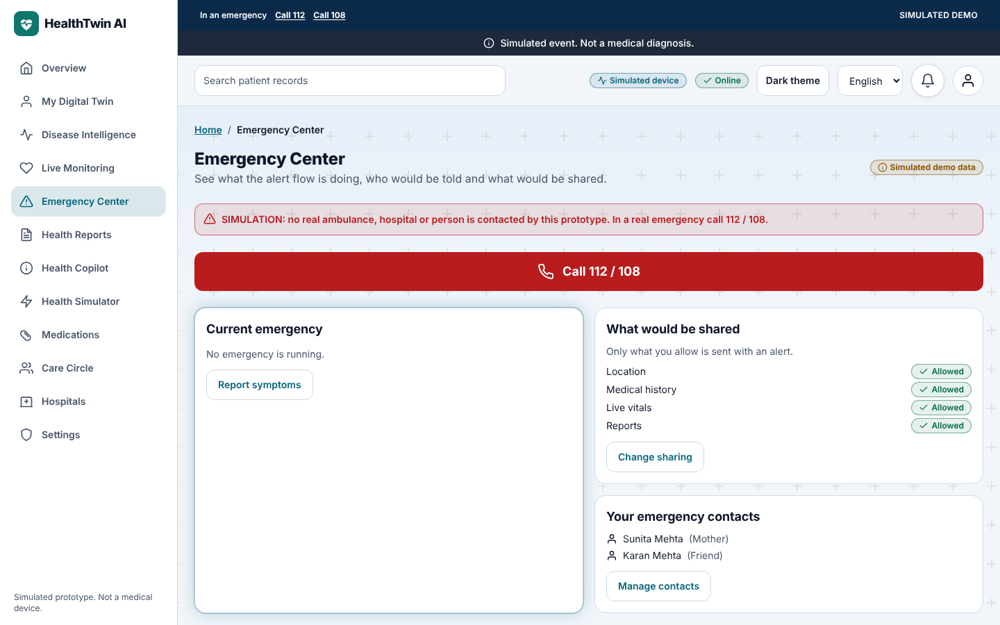 | 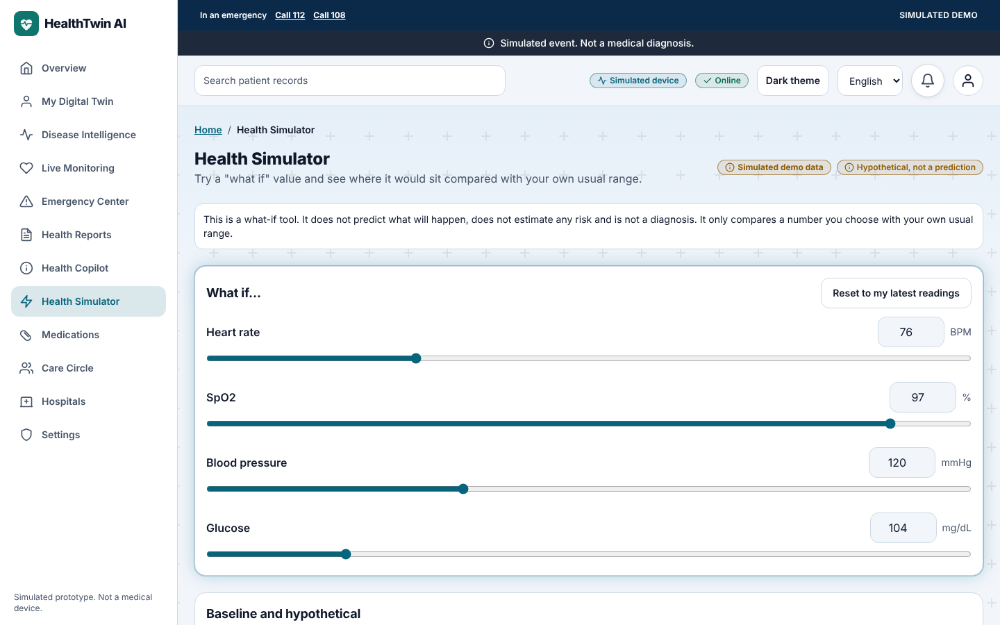 | 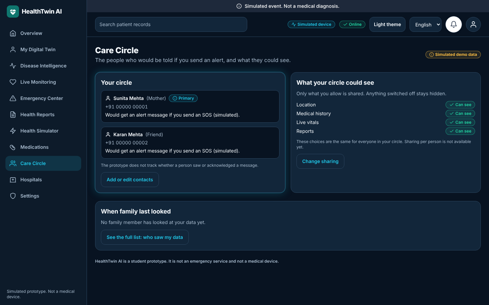 |

| Screen | What it does | Rule it follows |
|---|---|---|
| Overview, Twin | 2D and 3D body with area status | Status is rule-based; 3D falls back to 2D without WebGL or with reduced motion |
| Diseases, Monitor | Per-condition metrics, live ECG strip | Wording is "may need attention", never a diagnosis |
| Emergency Center | Timeline of an emergency | "Ambulance dispatched" appears only after that exact event; sent and acknowledged are separate |
| Reports | Lab values you type from a report | Twin changes only after you confirm; shows "not reviewed by a clinician" |
| Simulator | "What if" comparison | Hypothetical, assumptions listed, no advice |
| Care Circle, Copilot | Who sees what; rule-based helper | No AI model, answers come from fixed rules |

Dark and light themes, English / Hindi / Gujarati. `npm run audit` (axe-core) checks every screen at 360 px and 1440 px in both themes and all languages: no serious, critical or moderate findings and no sideways scrolling. Motion stops when the device asks for reduced motion.

## How it fits together

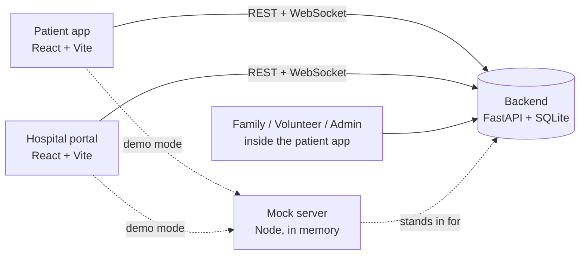

**Emergency flow:** `Monitoring → Symptoms reported → Emergency detected → SOS sent → Hospital acknowledged → Ambulance dispatched → En route → Arrived → Handover done`

## Repository layout

| Folder | What it is |
|---|---|
| [`backend/`](backend/README.md) | The real backend: FastAPI, SQLite, encryption, rules engine, audit log. Contract in [`backend/CONTRACT.md`](backend/CONTRACT.md) |
| [`patient-app/`](patient-app/README.md) | Patient app with family, volunteer and admin screens (English / Hindi / Gujarati, installable, works offline for the basics) |
| [`hospital-portal/`](hospital-portal/README.md) | Hospital desk portal |
| [`mock-server/`](mock-server/README.md) | In-memory fake backend used for demos and tests of the front ends |
| [`scripts/`](scripts) | Contract check, joint rehearsal, start-all script |
| [`docs/`](docs) | Project status, demo script, viva Q&A, accessibility, deployment and review sheets |
| [`docs/images/`](docs/images) | Screenshots used in this README |

## Quick start

**Requirements:** Node 22+ (front ends and mock), Python 3.11+ (backend).

### Option A — demo with the mock server (no Python needed)

```bash
npm install                     # installs patient-app + mock-server
npm run dev:all                 # mock on :4000, patient app on :5173

cd hospital-portal && npm install && npm run dev   # portal on :5174
```

On Windows PowerShell, `.\scripts\start-all.ps1` starts all three and checks the ports for you.

### Option B — real backend

```bash
cd backend
python -m venv .venv && source .venv/bin/activate
pip install -r requirements.txt
DEMO_MODE=true uvicorn app.main:app --port 8000
```

Then point an app at it with `VITE_API_URL=http://localhost:8000` (see each app’s `.env.example`).

### Demo logins

| Role | Email | Password |
|---|---|---|
| Patient | `patient@demo.test` | `demo1234` |
| Hospital staff | `staff@demo.test` | `demo1234` |
| Admin | `admin@demo.test` | `demo1234` |
| Family | `family@demo.test` | `demo1234` |
| Volunteer | `responder@demo.test` | `demo1234` |

Family invite code for the demo: `FAM-0417`. A 3-minute walk-through is in [`docs/DEMO_SCRIPT.md`](docs/DEMO_SCRIPT.md).

## Tests

| Part | Command | Covers |
|---|---|---|
| Backend | `cd backend && DEMO_MODE=true python -m pytest -q` | 2000+ tests: endpoints, privacy rules, audit, WebSocket, seed data |
| Contract | `python backend/scripts/contract_status.py` | Every served endpoint is in `CONTRACT.md` (prints `FREEZE READY`) |
| Patient app | `cd patient-app && npm run test:unit` | Unit tests incl. translation-file checks; `npm run test:browser` runs browser tests |
| Hospital portal | `cd hospital-portal && npm test && npm run lint` | Unit tests, lint; `npm run e2e` runs Playwright |
| Whole stack | `npm run contract` / `npm run integration` | Contract and joint rehearsal against a running server |

GitHub Actions runs the backend, patient-app and hospital-portal checks on every pull request.

### Hospital look and a real human body model

The patient app now opens in a light, hospital-website style (utility bar with 112 / 108 links, breadcrumb, hero banner, quick actions, footer with the simulated notice); dark mode is still available. The hospital portal matches it with a soft background, a header bar on the login page and a footer notice.

The 3D twin loads a real human anatomy model (skin, skeleton, organs) built from BodyParts3D, licensed CC BY 4.0. Credits, adaptations and rebuild steps: [`docs/MODEL_CREDITS.md`](docs/MODEL_CREDITS.md); the in-app About screen lists them too. You can tap an organ, switch layers (skin, skeleton, organs), and see front or back. Organ colour and a status word (within range / different from your baseline) come from the existing rule-based logic, not from the model. The note "Generic anatomy illustration. It is not a scan of your body." is always shown.

| Overview | 3D body model | Organ focus (heart) |
|---|---|---|
|  |  |  |

| 2D fallback (no WebGL) | Hospital portal login | Hospital portal dashboard |
|---|---|---|
| 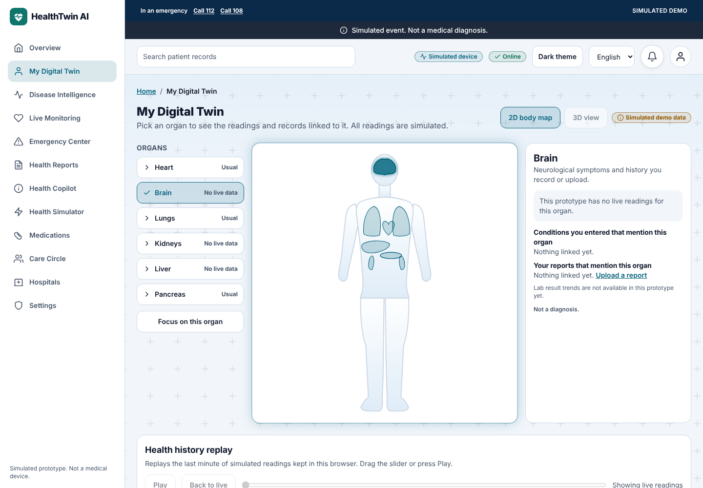 | 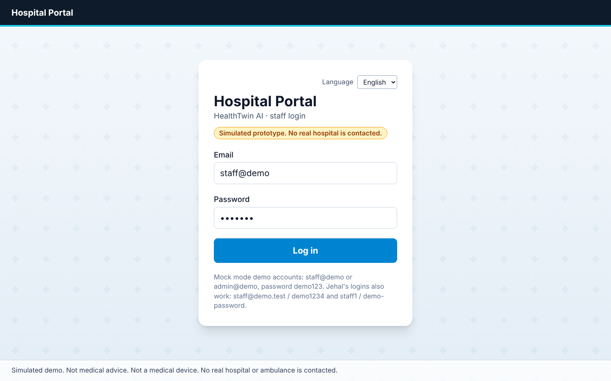 |  |

## Status and honest limits

| Item | State |
|---|---|
| Backend contract | Built and tested (`FREEZE READY`) |
| Demo flow | Works end to end on the mock server; the real backend passes its own tests |
| Apps against the real backend in a browser | Not fully rehearsed yet |
| Doctor review of symptom rules and guidance | Pending — see [`docs/CLINICAL_REVIEW.md`](docs/CLINICAL_REVIEW.md) |
| Native-speaker review of Hindi / Gujarati | Pending — see [`docs/TRANSLATION_REVIEW.md`](docs/TRANSLATION_REVIEW.md) |
| Real-device and accessibility check | Plan in [`docs/review/DEVICE_TEST_PLAN.md`](docs/review/DEVICE_TEST_PLAN.md) |
| Real SMS, calls, maps and wearables | Simulated on purpose |
| Hindi / Gujarati text on the new dashboard | AI-written drafts, layout checked, wording not reviewed |
| 3D twin | Tested in headless Chrome only; not on a real GPU or phone |
| Lab values on the dashboard | Stored on the device only; no backend endpoint yet (see [`docs/BACKEND_GAPS.md`](docs/BACKEND_GAPS.md)) |
| Clinician review of report values | Shown as "not reviewed"; no review workflow exists |
| Hospital portal | Restyled but light theme only |
| Body model contents | No muscles, nerves or reproductive organs; the lungs are a generic outline shape built around the airways (source has none); organ shapes are not personal |
| 3D model file | About 2.6 MB, not cached offline; offline or without WebGL a hand-drawn 2D body map is shown (a soft figure with organ shapes, simpler than the 3D model) |
| Model licence | CC BY 4.0 (attribution required, no share-alike); licence page re-check advised before public release |
| One admin browser test (A1) | Occasionally fails on CI and passes on rerun; cause not found |

More detail: [`docs/PROJECT_STATUS.md`](docs/PROJECT_STATUS.md) · [`docs/VIVA_QA.md`](docs/VIVA_QA.md) · [`docs/DEPLOY.md`](docs/DEPLOY.md) · [`CHANGELOG.md`](CHANGELOG.md)

## Team

| Person | Part |
|---|---|
| Jehal | Patient app, family / volunteer / admin screens, mock server, scripts |
| Puneet | Hospital portal and the hospital-side backend |
| Daksh | Backend: security, data, rules, audit, contract |
